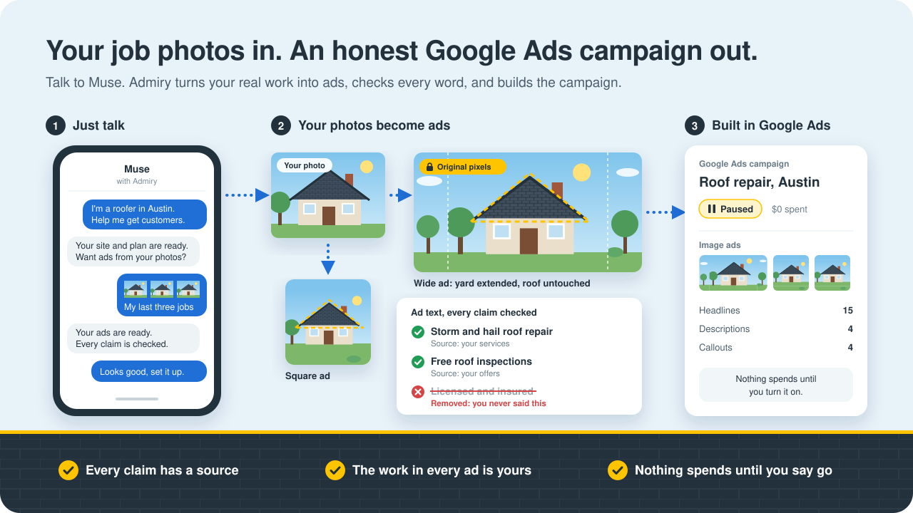

# Admiry on Muse

**Real work, true claims: a roofer's job photos become a verified Google Ads campaign in one conversation.**

Meta hackathon 2026 · Startups track · *Build for Your World*

Admiry is a marketing agent for local trades — roofers, remodelers, landscapers. An owner talks to **Muse**,
Meta's assistant, with the Admiry connector added. In that one conversation Admiry builds their website and
proposes a managed ad plan. **New in this hackathon:** Admiry turns the owner's own job photos into Google-ready
image ads and ad text, checks every claim against facts the owner gave and every image against Google's policy,
and, on the owner's OK, creates the Google Ads campaign in real time through the live Google Ads API. It is
created **paused**, so nothing is spent until the owner chooses.

<p align="center">
  
</p>

## The problem

A roofer is good at roofs and has a phone full of job photos. Running Google Ads still means writing headlines
under 30 characters, cropping images to Google's 1.91:1 and 1:1 sizes, and steering clear of claims they can't
back. Generic AI ad tools make the last part worse: they write "licensed and insured" for a business that never
said so, and they generate work the business never did.

Admiry does the reverse. The ads are made from the owner's real work and the owner's real facts, and anything it
can't verify is cut before it reaches Google.

## The demo

1. **In Muse:** "I'm a roofer in Austin, help me get customers." Admiry builds the site and the plan.
   *(existing Admiry)*
2. The owner adds 3–5 job photos from their phone through the upload link. *(existing Admiry)*
3. **"What ads would you run?"** → the new `suggest_ad_creatives` tool. Muse shows, per photo, a landscape and a
   square image ad plus headlines, descriptions and callouts:
   - each claim shows the profile fact it came from;
   - a **Removed** list says what the checker cut and why;
   - a before/after toggle shows which pixels are the owner's.
4. **"Looks good, set it up."** → the campaign, budget, ad group, keywords, responsive search ad, image assets and
   callout assets are created live in Google Ads, all paused. Muse answers with the campaign id and a link; the
   Google Ads UI shows the same campaign with the owner's images.

## How it stays honest

| Promise | How it is kept |
|---|---|
| Every claim has a source | Each headline, description and callout cites a fact from the owner's profile. A checker model rejects ungrounded claims and home-services compliance hits; rejected claims get at most two repair rounds, then are dropped. |
| The work in every image is the owner's | SAM cuts out the real work; the image model only extends the background to Google's sizes; our code then pastes the original pixels back (**pixel-lock**). A re-segmentation must find the work where it was (IoU ≥ 0.9), or the ad falls back to a plain crop of the original photo. |
| No text on images | Never drawn: Google's image-asset policy, and honesty. Checked on every output. |
| Nothing unchecked reaches Google | Anything that fails a check is not stored as accepted and is not sent. |
| Nothing spends | The `live_paused` mode sends the real create mutate but never enables a campaign, by any path. Allowlisted businesses only. |
| Owner content stays the owner's | Owner photos and facts go only to Standard-mode models (not Contributor mode, which allows training). |

## How it works

| Step | Model | What it does | If it fails |
|---|---|---|---|
| Read the photos | `muse-spark-1.3` (vision) | names the work ("new shingle roof"), judges ad suitability, flags faces, house numbers, plates and names | the photo is skipped |
| Cut out the work | `sam-3.1` | a mask of the real work | plain crop of the original |
| Extend to Google's sizes | `muse-image-1.0` | fills only the padding (sky, yard) around the original | plain crop of the original |
| Write the text | `muse-spark-1.3` | 15 headlines ≤ 30 chars, 4 descriptions ≤ 90, 4 callouts ≤ 25, each citing a fact | one retry with the validation error |
| Check the text | `muse-wonder-1.0` | grounded or not, compliance rule hits, per claim | `muse-spark-1.3` as checker, labeled |
| Check the images | `muse-wonder-1.0` + `sam-3.1` | Google image-asset policy, and the work's mask still where it was | plain crop of the original |

About **$0.10 per run** (4–6 images, SAM, and a few text calls).

## Existing Admiry vs built during the hackathon

**Pre-existing.** The whole [`agent/`](agent/) package was imported unchanged from Admiry's private repository
(at `6f6f213b`) in one commit, [`a9f6398`](https://github.com/chuang39/admiry-agent/commit/a9f6398). It is not
hackathon work. It contains the Muse connector (an MCP gateway with OAuth), the admiry.ai web chat, the website
builder, marketing plans, the managed Google Search campaign builder (validate-only on dev), the phone photo upload
page and the home-services knowledge. Its own docs: [`agent/README.md`](agent/README.md).

**Built during the hackathon.** Every commit after the import. Updated as each piece lands:

| # | Piece | Status |
|---|---|---|
| 0 | Run this repo's agent on the dev box and walk the existing flow: [`scripts/deploy-agent.sh`](scripts/deploy-agent.sh), [walk notes](docs/ops/dev-walk-2026-11-04.md) | done |
| N1 | **Creative studio** (`agent/creatives/`): job photos → Google image assets and ad text, each checked | planned |
| N2 | **Public tool `suggest_ad_creatives`** and the owner's acceptance, with a creatives card in Muse and the web chat | planned |
| N3 | **Google builder additions:** landscape and square image assets and callout assets linked to the campaign; accepted text feeds the responsive search ad | planned |
| N4 | **`live_paused` execution mode:** the real create mutate, everything paused, never enabled | planned |
| N5 | README, run notes, demo video | in progress |

Design: [spec](docs/superpowers/specs/2026-11-04-muse-verified-creatives-google-ads-design.md) ·
[implementation plan](docs/superpowers/plans/2026-11-04-muse-verified-creatives-google-ads.md)

## Run it locally

Needs Python 3.12, Postgres and a Meta Model API key.

```bash
uv venv --python 3.12
uv pip install -r agent/requirements.txt pytest ruff
createdb bidx_agent
export META_MODEL_API_KEY=...       # Meta Model API key
.venv/bin/python -m agent           # http://localhost:8097/health, /mcp, /connect/docs
```

Mint a business key and point an assistant's MCP connector at `http://localhost:8097/mcp`
(`Authorization: Bearer ak_…`):

```bash
.venv/bin/python -m agent.keys mint --class business --business <business-id> --scopes read,manage,leads --label muse
```

Tests use their own database:

```bash
createdb admiry_hack_test
AGENT_TEST_DB_URL=postgresql:///admiry_hack_test .venv/bin/pytest
```

Lint with `ruff format` and `ruff check` (settings in [`pyproject.toml`](pyproject.toml), line length 120) on every
Python file you touch.

## Repository layout

| Path | What |
|---|---|
| [`agent/`](agent/) | the Admiry agent: FastAPI app, MCP endpoint at `/mcp`, Postgres schema, tools, site builder, Google Search channel, tests |
| `agent/creatives/` | the creative studio (N1, landing during the hackathon) |
| [`docs/superpowers/`](docs/superpowers/) | the hackathon design and implementation plan |
| [`docs/ops/`](docs/ops/) | run notes from the dev box |
| [`scripts/`](scripts/) | dev-box deploy |

## License

No license file: all rights reserved.
